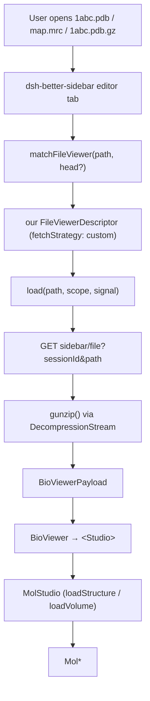

# AGENTS.md — dsh-bioviewer

Guidance for agents and humans working in this repository. Read this before
changing the client half: most of it records host behaviours that are not
discoverable from this repo's own code and that fail *silently* when broken.

## What this is

A **DeepSeek Harness plugin** that renders biomolecular files from the filesystem
in the DSH sidebar. It is a *consumer* of the third-party
[`dsh-better-sidebar`](https://github.com/omdsh-dev/DSH-better-sidebar) service:
it owns no sidebar, no file tree and no state store of its own — it registers
descriptors and renders components.

The viewer stack is Mol\* via `@molstudio/react`, the same stack as the
[BioViewer VS Code extension](https://github.com/shuuul/bioviewer), and
`@molstudio/core`'s controller API is the only surface this plugin uses to drive
Mol\*.

## Commands

| Command | What it does |
| --- | --- |
| `bun install` | Install dependencies |
| `bun run build` | Build `lib/index.js` (host half) and `lib/client.js` (client half) + `.d.ts` |
| `bun run typecheck` | `tsc -p tsconfig.json --noEmit` |
| `bun run lint` | `oxlint` |
| `bun test` | `bun:test` suite |
| `bun run verify:fast` | lint → typecheck → build → test. **The gate**: `.husky/pre-push` and CI both run exactly this |
| `bun run build --no-minify` | Unminified bundle, for reading the emitted code |

Hooks: `pre-commit` runs `oxlint` on staged files (seconds, no tests);
`pre-push` runs `verify:fast`; `commit-msg` enforces Conventional Commits.
Do not add a second hook runner.

## Architecture

| Path | Role |
| --- | --- |
| `src/index.ts` | **Host half.** Intentionally minimal: it exists so the loader can mount the plugin and discover the client half. All behaviour is client-side. |
| `src/client/index.tsx` | **Client half entry.** Registers the viewers, the compressed-file sniffer and the browser tab. Owns stylesheet injection and the host-route resolver. |
| `src/shared/formats.ts` | Pure format table + `detectBioFile` / `isBioFile`. Zero imports. |
| `src/client/bytes.ts` | Fetches raw bytes from the host media route and gunzips them. |
| `src/client/load.ts` | `loadIntoStudio`: routes a payload to `loadStructure`/`loadVolume`, and replaces a same-label object instead of stacking a duplicate. |
| `src/client/studio.tsx` | `BioViewer`: pure renderer of an already-fetched payload. |
| `src/client/browser.tsx` | The "BioViewer" tab page (workspace bio-file navigator). |
| `src/client/cmm.ts` | Pure `.cmm` parser (React-free). The marker pane component is `MarkerNotice` in `file-view.tsx`. |
| `src/client/file-view.tsx` | The viewer's leaf components (`BioFileView`, `BioPayloadView`, `MarkerNotice`, `BioNotice`) and the payload dispatcher. |
| `src/client/theme.ts` | DSH colour-scheme detection (mirrors the host's own logic). |
| `scripts/build.ts` | The build. Produces both halves and the `__ModuleLoader__` wrapper. |

## Host contracts you must not break

These were read out of the installed `dsh-better-sidebar@0.28.2` and
`@molstudio/core`, not assumed. Each one fails quietly if you get it wrong.

1. **`fetchStrategy: 'custom'` means *we* fetch.** The host calls
   `load(path, scope, signal)` and renders the component with the resolved value
   as `customData`; it never calls `fs.read` for us. That single fetch point is
   what gives us the host's `AbortSignal` and its automatic reload after a
   successful model `write`/`edit`. Fetching inside the component would
   double-fetch and lose both.

2. **Viewer `exts` are matched against the LAST dot segment.** `extOf()` in
   `dsh-better-sidebar/src/client/paths.ts` returns `path.slice(lastIndexOf('.') + 1)`,
   so `1abc.pdb.gz` has extension **`gz`**, not `pdb.gz`. Consequences:
   - never put a compound `"pdb.gz"` in a descriptor's `exts` — it can never match;
   - never put `"gz"` in a per-format `exts` — pass one would claim *every* `.gz`
     file in the workspace;
   - compressed files are routed by the **sniff-only catch-all** in
     `src/client/index.tsx` (`exts: []` + `detect`). The host yields on it while
     no head bytes exist, then consults it on the binary re-match, where `detect`
     sees the gzip magic.

3. **The client bundle is a classic script, not a module.** It must register a
   factory via `window.__ModuleLoader__.load({ id, factory })`, where `id` equals
   the package name. The factory receives a synchronous `require` that resolves
   only shell-owned specifiers; anything else throws loudly at materialization.
   Keep the external list exactly `react`, `react-dom`, `react-dom/client`,
   `react/jsx-runtime` — everything else (Mol\*, MolStudio) is bundled.

4. **The host's React is 18.3.1.** `@molstudio/react` declares a React 19 peer,
   but its code uses only React 18 APIs (`useId`, `useSyncExternalStore`, …).
   Do not introduce a React 19-only API.

5. **A native tab body is a fixed-height block scroller, not a flex container.**
   Every component root needs `height: 100%; min-height: 0`.

6. **`hostRouteUrl()` resolves host routes — never write a leading slash.**
   `fetch('/sidebar/api/…')` pins the request to the origin root and breaks
   reverse proxies that mount the GUI under a sub-path.

7. **Better-sidebar is an optional peer.** It must never appear in a static
   `inject` list, or the plugin would sit pending forever on a host without it.
   Registration goes through `ctx.inject(['betterSidebar'], …)`.

8. **One style element id per owner.** Both `index.tsx` and `browser.tsx` inject
   a stylesheet with the "create it if it is not already there" pattern; a shared
   id makes whichever runs second inject nothing, silently.
   `tests/style-ids.test.ts` pins uniqueness.

9. **Reload replaces, it does not append.** `MolStudio.loadStructure` has no
   dedupe, so a naive reload stacks a second object with the same label.
   `loadIntoStudio` removes same-label objects first via the public
   `getSnapshot()` / `remove(id)`.

## Conventions

- **Format identifiers are facts, not choices.** `molstarFormat` values must come
  from Mol\*'s built-in lists (trajectory: `mmcif`, `cifCore`, `pdb`, `pdbqt`,
  `pqr`, `gro`, `xyz`, `lammps_data`, `lammps_traj_data`, `mol`, `sdf`, `mol2`;
  volume: `ccp4`, `dsn6`, `cube`, `dx`, `dscif`). Verify against
  `node_modules/molstar` before adding one.
- **Styling is token-only.** Consume `--dsw-alias-*` / `--dsw-font-*` / `--ds-*`;
  no hardcoded colors. `tests/theme` does not exist here, so this is on review.
- **`import type {} from "dsh-better-sidebar/client/service"`** is the only
  permitted reference to that package in `src/`. It is erased at build time and
  is what pulls in the `ctx.betterSidebar` type augmentation. Never value-import
  it.
- **Comments explain *why*, and cite the source line** when a behaviour was read
  out of a dependency. Several comments here are load-bearing: they record
  measurements (`extOf` output, `builtinViewers` contents) that cost real time to
  establish.
- Conventional Commits are required (`feat`, `fix`, `docs`, `test`, `chore`, …).
- **`README.md` is Chinese; `README_EN.md` is its English mirror.** Chinese is the
  primary, so a change lands in `README.md` first and `README_EN.md` follows in the
  same commit. They must link to each other, and `tests/readme.test.ts` fails if
  either one stops documenting an extension or a Mol\* reader the format table
  claims, or if the two grow a different number of `##` sections. Add new sections
  to both.
- Add a test next to any behaviour you fix. The suite is fast (~2 s) and is the
  only regression net for the routing rules above.

## Testing notes

- `bun test` imports `.tsx` sources directly — prefer testing the real module
  with a hand-written fake over testing a copy of the logic.
- The verifier's tests in `tests/build.test.ts`, `tests/contract.test.ts` and
  `tests/registration.test.ts` check the **built** artifact and the **installed**
  `dsh-better-sidebar` types. They are the anti-drift net: if the dependency
  changes shape, they fail.
- `tests/build.test.ts` extracts `require()` specifiers from `lib/client.js` and
  cross-checks the static scan against a runtime scan. Its scanner is
  deliberately **fail-closed** (it may over-report, never under-report) — if it
  reports a specifier outside the allowlist, investigate; do not loosen it.
- `tests/molstar-formats.test.ts` asserts every `molstarFormat` in the table is a
  member of Mol\*'s real built-in reader registry. `tsc` cannot check those
  strings, and a wrong one only fails when a user opens a file.

## Releasing

There is **no release workflow**, by design: nothing is published yet, and this
repo has not opted into release-please. When a release is wanted, the manual
sequence is:

1. `bun run verify:fast` on a clean checkout, plus the full `bun test` suite.
2. Bump `version` in `package.json` and commit it (`chore(release): vX.Y.Z`).
3. Tag and push: `git tag vX.Y.Z && git push origin main --tags`.
4. `npm publish` (the `files` list already ships `lib`, `src`, `cordis.patch.yml`,
   `icon.svg`, `locale/*.json`, `README.md`, `README_EN.md` and `LICENSE`).
5. Consumers install with `dsh plugin --profile <name> add dsh-bioviewer@X.Y.Z`.

Two constraints to preserve if automation is ever added: release workflows must
be `workflow_dispatch`-only (never on push or tag push), and publishing should
use npm trusted publishing rather than a long-lived token. Note also the
marketplace manifest rules the plugin already satisfies — `dependencies` /
`peerDependencies` / `optionalDependencies` must never contain the unscoped
`cordis` package, and `scripts` must not contain install-time hooks.
`tests/manifest.test.ts` pins the first of those.
