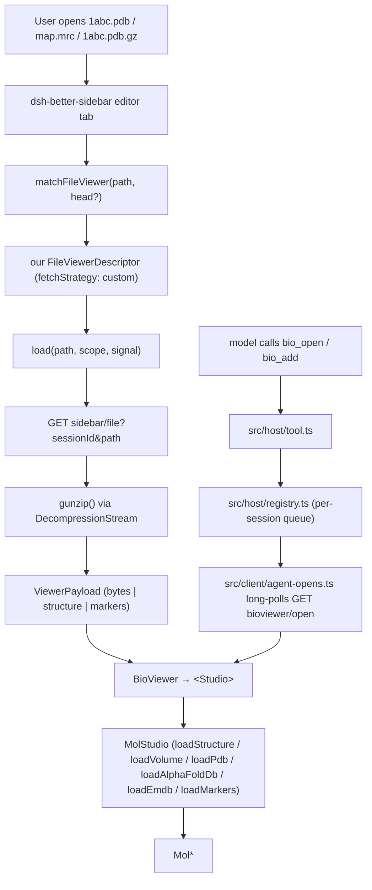

# AGENTS.md — dsh-bioviewer

Guidance for agents and humans working in this repository. Read this before
changing the client half: most of it records host behaviours that are not
discoverable from this repo's own code and that fail *silently* when broken.

## What this is

A **DeepSeek Harness plugin** that renders biomolecular files from the filesystem
in the DSH sidebar. It is a *consumer* of the third-party
[`dsh-better-sidebar`](https://github.com/omdsh-dev/DSH-better-sidebar) service:
it owns no sidebar, no file tree and no state store of its own — it registers
descriptors and renders components.

The viewer stack is Mol\* via `@molstudio/react`, the same stack as the
[BioViewer VS Code extension](https://github.com/shuuul/bioviewer), and
`@molstudio/core`'s controller API is the only surface this plugin uses to drive
Mol\*.

## Commands

| Command | What it does |
| --- | --- |
| `bun install` | Install dependencies |
| `bun run build` | Build `lib/index.js` (host half) and `lib/client.js` (client half) + `.d.ts` |
| `bun run typecheck` | `tsc -p tsconfig.json --noEmit` |
| `bun run lint` | `oxlint --deny-warnings` — a warning fails the gate, not just the log |
| `bun test` | `bun:test` suite |
| `bun run check:specs` | Validate tracked spec structure, lifecycle, IDs and index |
| `bun run verify:fast` | specs → lint → typecheck → build → test. **The gate**: `.husky/pre-push` and CI both run exactly this |
| `bun run screenshots` | Rebuild App Store-style product shots into `docs/screenshots/` (needs local Chrome + ffmpeg) |
| `bun run sync:molstudio-assets` | Regenerate `src/client/generated/molstudio-assets.ts` (embedded wasm + worker) from the installed `@molstudio/core`; the gate fails if it is stale |
| `bun run build --no-minify` | Unminified bundle, for reading the emitted code |

Hooks: `pre-commit` runs `oxlint` on staged files (seconds, no tests);
`pre-push` runs `verify:fast`; `commit-msg` enforces Conventional Commits.
Do not add a second hook runner.

## Tracked specs

Use [specs/README.md](specs/README.md) for long-running, cross-repository or parallel
work that needs explicit acceptance and handoff. Reserve the next continuous ID
across `specs/` and `specs/archive/`, copy the template and index an Active spec
before implementation/parallel work. Never reuse, renumber or delete an ID.

The coordinator owns frontmatter, scope, shared decisions, index and closeout;
workers claim stable workstream rows before editing and append dated handoffs.
Only Draft/Active (in `specs/`) and Completed (in `specs/archive/`) are spec statuses;
blocked work is a workstream state with evidence, owner and next action.

Before closeout, satisfy or explicitly remove each acceptance criterion, sync
durable behavior into code/tests/docs and the nearest guidance, record exact
commands/results and any final experiment Git refs, and fill the completion summary.
Run `bun run check:specs` and `bun test tests/specs.test.ts` before and after moving
the same filename to `archive/` with Completed status and its index row in one change.
Keep frontmatter flat scalar and the two index tables numerically ascending.

`docs/VERIFICATION.md` points to historical evidence preserved byte-for-byte under
`specs/archive/evidence/`; it is not current acceptance. Do not rewrite it or claim
its unfinished browser/UI checks completed without fresh evidence in the active spec.
The dependency-free validator runs from cwd, and regression fixtures execute the real
script. CI must run the shared gate on Markdown/spec-only PRs too. Preserve Bun
1.4.4 in packageManager/CI (update both deliberately) and the existing manual-only
release policy; a spec-system change is not permission to add release automation.

## Architecture



Note the two independent entry points into the same viewer: a user clicking a
file goes through better-sidebar's matcher and our `load()`, while an agent open
or add goes through the tool and the poll loop. `bio_open` always makes a new
tab; `bio_add` stacks into the live studio (or opens one if none exists). Both
end at `BioViewer`.

| Path | Role |
| --- | --- |
| `src/index.ts` | **Host half.** Owns the `bio_open` / `bio_add` tools and their long-poll route; also the loader row that makes the client half discoverable. |
| `src/host/tool.ts` | `bio_open` and `bio_add`: resolve the calling session and cwd, map the target, queue it. |
| `src/host/target.ts` | Pure target → `OpenRequest` mapping (no cordis, no DSH imports, so it tests alone). |
| `src/host/registry.ts` | Per-session open queue + parked long-poll waiters (consume-once, bounded). |
| `src/host/route.ts` | The fenced `GET /bioviewer/open` long poll. |
| `src/client/index.tsx` | **Client half entry.** Registers the viewers, the compressed-file sniffer and both tabs. Owns stylesheet injection and the host-route resolver. |
| `src/client/agent-opens.ts` | The poll loop that receives agent opens/adds and dispatches them. |
| `src/client/studios.ts` | Live MolStudio registry so `bio_add` can stack into the current canvas. |
| `src/client/transport.ts` | Prefix-safe URL resolution for this plugin's own host routes. |
| `src/shared/formats.ts` | Pure format table + `detectBioFile` / `isBioFile`. Zero imports. |
| `src/shared/opens.ts` | The agent-open wire contract (`OpenRequest`, `parseOpenTarget`, …). Shared by both halves. |
| `src/client/bytes.ts` | Fetches raw bytes from the host media route and gunzips them. |
| `src/client/load.ts` | `loadIntoStudio`: routes a payload to `loadStructure`/`loadVolume`/`loadPdb`/…/`loadMarkers`, and replaces a same-label object instead of stacking a duplicate. |
| `src/client/studio.tsx` | `BioViewer`: renderer of an already-fetched payload; registers its studio so `bio_add` can stack further objects. |
| `src/client/browser.tsx` | The "BioViewer" tab page (workspace bio-file navigator). |
| `src/client/cmm.ts` | Pure, DOM-free `.cmm` parser producing `@molstudio/core`'s `MarkerSet[]`. |
| `src/client/file-view.tsx` | The viewer's leaf components (`BioFileView`, `StructureTabView`, `BioNotice`). Every payload carries a `kind`, so there is one render path. |
| `src/client/theme.ts` | DSH colour-scheme detection (mirrors the host's own logic). |
| `src/client/surface-engine.ts` | The 0.1.6 wasm surface-engine wiring: `<Studio studioOptions>` gets an embedded data-URL wasm plus a blob-URL worker, with the packaged defaults left dead. |
| `src/client/generated/molstudio-assets.ts` | Generated wasm bytes, worker source and their digests. Regenerate with `bun run sync:molstudio-assets`; never edit by hand. |
| `scripts/build.ts` | The build. Produces both halves, the `__ModuleLoader__` wrapper, and defines an inert `import.meta.url` so no builder path lands in the bundle. |
| `scripts/sync-molstudio-assets.ts` | Regenerates the embedded MolStudio wasm/worker assets from `node_modules`; `tests/wasm-asset.test.ts` enforces the copies. |

## Host contracts you must not break

These were read out of the installed `dsh-better-sidebar` and
`@molstudio/core`, not assumed. Each one fails quietly if you get it wrong.

1. **`fetchStrategy: 'custom'` means *we* fetch.** The host calls
   `load(path, scope, signal)` and renders the component with the resolved value
   as `customData`; it never calls `fs.read` for us. That single fetch point is
   what gives us the host's `AbortSignal` and its automatic reload after a
   successful model `write`/`edit`. Fetching inside the component would
   double-fetch and lose both.

2. **Viewer `exts` are matched against the LAST dot segment.** `extOf()` in
   `dsh-better-sidebar/src/client/paths.ts` returns `path.slice(lastIndexOf('.') + 1)`,
   so `1abc.pdb.gz` has extension **`gz`**, not `pdb.gz`. Consequences:
   - never put a compound `"pdb.gz"` in a descriptor's `exts` — it can never match;
   - never put `"gz"` in a per-format `exts` — pass one would claim *every* `.gz`
     file in the workspace;
   - compressed files are routed by the **sniff-only catch-all** in
     `src/client/index.tsx` (`exts: []` + `detect`). The host yields on it while
     no head bytes exist, then consults it on the binary re-match, where `detect`
     sees the gzip magic.

3. **The client bundle is a classic script, not a module.** It must register a
   factory via `window.__ModuleLoader__.load({ id, factory })`, where `id` equals
   the package name. The factory receives a synchronous `require` that resolves
   only shell-owned specifiers; anything else throws loudly at materialization.
   Keep the external list exactly `react`, `react-dom`, `react-dom/client`,
   `react/jsx-runtime` — everything else (Mol\*, MolStudio) is bundled.

4. **The host's React is 18.3.1.** `@molstudio/react` declares a React 19 peer,
   but its code uses only React 18 APIs (`useId`, `useSyncExternalStore`, …).
   Do not introduce a React 19-only API.

5. **A native tab body is a fixed-height block scroller, not a flex container.**
   Every component root needs `height: 100%; min-height: 0`.

6. **`hostRouteUrl()` resolves host routes — never write a leading slash.**
   `fetch('/sidebar/api/…')` pins the request to the origin root and breaks
   reverse proxies that mount the GUI under a sub-path.

7. **Better-sidebar is an optional peer.** It must never appear in a static
   `inject` list, or the plugin would sit pending forever on a host without it.
   Registration goes through `ctx.inject(['betterSidebar'], …)`.

8. **One style element id per owner.** Both `index.tsx` and `browser.tsx` inject
   a stylesheet with the "create it if it is not already there" pattern; a shared
   id makes whichever runs second inject nothing, silently.
   `tests/style-ids.test.ts` pins uniqueness.

9. **Reload replaces, it does not append — keyed on label AND kind.**
   `MolStudio.loadStructure` has no dedupe, so a naive reload stacks a second
   object with the same label. `loadIntoStudio` removes matching objects first
   via the public `getSnapshot()` / `remove(id)`, and the key is a pair:
   - **label**: for database entries the payload title alone is not enough,
     because the loaders name the object themselves (`loadPdb` uppercases the id,
     `loadEmdb` normalises to `EMD-1234`, `loadAlphaFoldDb` uses the API's
     `entryId`), so `structureLabels()` matches against every label MolStudio can
     actually produce. AlphaFold matches existing labels in the exact
     `AF-<accession>-` namespace as well as its fallback, never a guessed `F1`
     suffix or an accession prefix without its separator.
   - **kind**: `StudioObject` is a discriminated union, and matching on the label
     alone would let a marker set called `markers` delete a structure that merely
     shares the name. The kind is per source, not per route — **`loadEmdb`
     produces a `volume`, not a structure** (it applies `DownloadDensity` and
     reads the result out of `plugin.managers.volume.hierarchy`), so keying EMDB
     as `"structure"` matches nothing on reload and silently restores the
     duplicate-stacking bug. When a studio cannot report a kind the match falls
     back to label-only, so it replaces rather than silently removing nothing.
   Removal and load are serialized together per studio. Queued work uses its
   effect's AbortSignal so superseded requests never start. Core **0.1.5** makes
   `getSnapshot()` flush a scheduled rebuild, so a read right after an awaited
   load sees the committed objects; the queue still yields before reading —
   harmless on 0.1.5 and required on the 0.1.4 build, where snapshots were batched
   on a timer and a resolved loader alone did not guarantee its objects were in
   the snapshot.
   Database-tab payload identities must stay stable across theme/parent renders:
   `BioViewer` intentionally uses a new payload identity as the file-reload signal.

10. **`ctx.sidebarRight` is client-only, so an agent open needs a host route.**
    `@deepseek-ai/dsh-client-ui-sidebar-right`'s host half is literally
    `export declare function apply(): void` — "the Sidebar contributes nothing to
    the host tree". There is therefore **no host-side API** that pushes an open
    into the browser, which is why `bio_open` / `bio_add` exist: the tool queues
    a request (`src/host/registry.ts`), the client long-polls it back
    (`GET /bioviewer/open`), and the client either calls `ctx.betterSidebar.openFile`
    / `openTab` (`bio_open`, or the first `bio_add`) or `loadIntoStudio` on the
    live canvas (`bio_add` once a studio has registered). Do not "simplify" this
    into a host-side sidebar call; there isn't one. Two consequences worth remembering: the poll is **consume-once**, so a
    request reaches exactly one client (same guarantee better-sidebar's
    agent-open socket gives), and `apply()` must never throw on a partial service
    — `registerAll` capability-checks `getSnapshot`/`subscribeState` and degrades
    to "agent opens disabled" rather than taking the viewers down with it.

11. **Never read a host service with `ctx.get` at `apply()` time.** This plugin's
    activation is **not** ordered after the services it uses, and the race is
    silent: `apply()` ran before the webserver was provided, `ctx.get("webServer")`
    returned `undefined`, both host registrations took their documented
    "degrade to a no-op + log" path, and the plugin *looked* mounted while
    `/bioviewer/open` answered the server's generic 404 with no `content-type`.
    Nothing threw and no test failed — a fake ctx whose `get` always answers
    cannot see this. Use `ctx.inject([...], (scoped) => scoped.effect(...))`
    instead: registration happens the moment the services exist, the UI half is
    still not gated (a static `inject` would block the whole plugin), and a host
    that never provides them never registers. `tests/host-tool.test.ts` models the
    real ordering (`inject: "now" | "manual" | "never"`) and pins the dep list.
    Only a live `dsh --profile web` run caught this, so re-run the host check in
    "Verifying on a real host" below after touching `src/index.ts`.

12. **Marker models are drawn by `@molstudio/core`, not by us — and that needs
    0.1.4.** Mol\* 5.13 genuinely has no public shape builder (`plugin.builders`
    is only `data`, `structure`, `preset`), and that is what an earlier version of
    this file wrongly concluded made `.cmm` unrenderable. MolStudio builds the
    shape node itself: `MolStudio.loadMarkers(set)` adds a set as one object, and
    `setMarkerColor` / `setMarkerSize` drive its display. **This API does not
    exist in 0.1.3** — markers need ≥ 0.1.4 and the repo pins `^0.1.6` (the wasm
    wiring below needs 0.1.6); lowering the pin silently turns every marker model
    back into an error and disables the wasm engine. `src/client/cmm.ts` therefore
    only has to produce `MarkerSet[]`; `loadIntoStudio` hands each set to
    `loadMarkers`, and markers render *beside* other objects, which is the point
    (prompt points over a density map).

13. **The wasm surface engine is embedded, never routed.** `@molstudio/core` 0.1.6
    builds its 54 KB `molstudio-wasm-engine.wasm` and its worker from
    `import.meta.url` (`dist/compute/wasm-core.js`, `dist/compute/worker-engine.js`'s
    `createDefaultWorker`). Our client half is one classic script (`import.meta` is
    not a module) and the shell serves no sibling asset, while Bun *rewrites*
    `import.meta.url` to the build machine's absolute `file://` path — so both
    packaged defaults point at nothing and the engine silently falls back to
    Mol*'s parsed isosurface (no error anywhere). `scripts/sync-molstudio-assets.ts`
    therefore generates `src/client/generated/molstudio-assets.ts` (wasm base64,
    worker IIFE, digests), `src/client/surface-engine.ts` turns them into a data
    URL plus a blob-URL `makeWorker`, and `src/client/studio.tsx` passes
    `studioOptions={STUDIO_OPTIONS}`. `tests/wasm-asset.test.ts` fails when the
    installed package moves without a re-sync, so a MolStudio bump is
    `bun install` + `bun run sync:molstudio-assets`. `StudioProps.studioOptions`
    and `MolStudioOptions.surfaceEngine` do not exist before 0.1.6, so the pin is
    `^0.1.6` — lowering it is a type error (and forcing it disables the engine).

## DSH version coupling

The repo targets **DSH 0.2.2-rc.1**, the runtime inside the desktop app:
`@deepseek-ai/*` devDependencies are `^0.2.2-rc.1`, the
`@deepseek-ai/dsh-tools` **peer** floor is `^0.2.2-rc.1`, the
`@deepseek-ai/cordis` peer is `^4.1.0` (the host's own cordis), and `engines.node`
is `>=24.9` (the host's own minimum). The optional `dsh-better-sidebar` peer spans
every version the code supports (`>=0.28.0 <0.31.0`, tested against 0.30.1).
The bump surfaced two resolution traps, one stricter host registration and one
non-change worth pinning:

- **A pre-release does not satisfy a plain caret range of an older series.**
  `^0.2.1-rc.1` does *not* admit `0.2.2-rc.1`: npm only lets a pre-release match a
  comparator set that names a pre-release of its own `[major,minor,patch]` tuple.
  The peer floor therefore has to move with the host even when the code is
  source-compatible — otherwise a package manager that enforces peers rejects the
  plugin on the very host the repo tests against. `tests/contract.test.ts` pins
  this: every declared peer range must admit the version CI actually installs.
- **One `cordis` copy is what the typecheck needs.** `dsh-better-sidebar` 0.28.2
  declared its DSH peers as `^0.2.1-rc.1`, which excludes the 0.2.2 pre-releases,
  so bun nested a full 0.2.1 closure — its own `@deepseek-ai/cordis` included —
  under `node_modules/dsh-better-sidebar/`. The package's
  `declare module '@deepseek-ai/cordis'` augmentation for `ctx.betterSidebar`
  merged into that nested copy while `src/client/index.tsx` imported the hoisted
  one, so the augmentation silently disappeared and `tsc` reported `Property
  'betterSidebar' does not exist on type 'Context'` (a temporary `tsconfig.json`
  `paths` remap papered over it). **0.30.1 declares `^0.2.2-rc.1` peers**, the
  nesting is gone, and the remap was removed with the bump. If a future pin
  reintroduces a closure that excludes the host's version, check
  `node_modules/dsh-better-sidebar/node_modules/@deepseek-ai/` before reaching for
  `paths`; the honest fix is a sidebar release whose ranges admit the host.
- **`ToolsService.register` got stricter.** 0.2.2 throws unless the tool declares
  `output { schema, render }` and the compiled schema stays inside the enforced
  JSON-Schema subset (object nodes need explicit `additionalProperties`; in the
  author DSL every output property carries `required: true`, which `defineTool`
  compiles to a root `required` array). The plugin already complies, but a fake
  ctx cannot observe that throw, so `tests/host-tool.test.ts` validates the
  captured definitions with the installed `assertSupportedJsonSchema`, and a real
  host run remains the gate after touching `src/host/tool.ts`.
- **The client shell contract did not move.** The 0.2.2 shell still installs
  factories via `window.__ModuleLoader__.load({ id, factory })` and still ships
  React 18.3.1. Its seed table now has **11** module-table entries — the four React
  specifiers our bundle keeps external (`react`, `react-dom`, `react-dom/client`,
  `react/jsx-runtime`) plus `@deepseek-ai/cordis`, `zod`,
  `@tanstack/react-virtual`, `@deepseek-ai/dsh-client-store`,
  `@deepseek-ai/dsh-client-ui-slots`, `@deepseek-ai/dsh-client-ui-primitives` and
  `@deepseek-ai/dsh-client-ui-dockkit` (the `YZ()` table in
  `@deepseek-ai/dsh-web-frontend/dist/assets/index-*.js`). Our external list does
  not change; the extra seeds are what keep `dsh-better-sidebar` 0.30.1 loadable —
  it requires `@deepseek-ai/dsh-client-ui-primitives`, which is a seed word but not
  a boot row. The manifest schema is still `manifestVersion: 1` with
  `dsh.client.platform: "web"`; 0.2.2 only adds optional fields. No client code
  change was needed for the bump.

## Verifying on a real host

The host must be **0.2.2-rc.1 or newer** (`dsh --version`). Unit tests with a fake
ctx cannot see ordering, activation or HTTP behaviour.
The cheap end-to-end check uses a **throwaway** `DSH_HOME` so the user's
`~/.dsh` is never touched:

```sh
export DSH_HOME=/tmp/dsh-verify && mkdir -p "$DSH_HOME"
dsh plugin --profile web add "link:$PWD"        # auto-appends from dsh.bundle.patch
dsh plugin --profile web add dsh-better-sidebar@0.30.1
dsh --profile web --dump-config | grep -A2 dsh-bioviewer   # row composed?
dsh --profile web --no-open --port 59391        # background job; read the token URL
```

Then, with the token exchanged for a cookie:

| Probe | Expected |
| --- | --- |
| `GET /` | 200; `window.__DSH_BOOT__` contains a `dsh-bioviewer` row |
| `GET /plugins/??dsh-bioviewer/client.js&rev=…` | 200, `text/javascript`, ~3.3 MB |
| `GET /bioviewer/open?sessionId=x` (no cookie) | **403 with our JSON body** — a bare 404 means the route never registered |
| `GET /bioviewer/open?sessionId=x` (cookie) | held **25 s**, then `200 {"ok":true,"value":{"request":null}}` |
| `GET /bioviewer/open` (no sessionId) | `400` `bad-request` |

Kill the job afterwards, delete the temp home, and confirm the user's own GUI is
untouched. Booting a *replacement* server for the user's GUI is never the goal —
this one exists only to exercise the host half and is torn down immediately.

## Conventions

- **Format identifiers are facts, not choices.** `molstarFormat` values must come
  from Mol\*'s built-in lists (trajectory: `mmcif`, `cifCore`, `pdb`, `pdbqt`,
  `pqr`, `gro`, `xyz`, `lammps_data`, `lammps_traj_data`, `mol`, `sdf`, `mol2`;
  volume: `ccp4`, `dsn6`, `cube`, `dx`, `dscif`). Verify against
  `node_modules/molstar` before adding one.
- **Styling is token-only.** Consume `--dsw-alias-*` / `--dsw-font-*` / `--ds-*`;
  no hardcoded colors. `tests/theme` does not exist here, so this is on review.
- **`import type {} from "dsh-better-sidebar/client/service"`** is the only
  permitted reference to that package in `src/`. It is erased at build time and
  is what pulls in the `ctx.betterSidebar` type augmentation. Never value-import
  it.
- **Comments explain *why*, and cite the source line** when a behaviour was read
  out of a dependency. Several comments here are load-bearing: they record
  measurements (`extOf` output, `builtinViewers` contents) that cost real time to
  establish.
- Conventional Commits are required (`feat`, `fix`, `docs`, `test`, `chore`, …).
- **`README.md` is Chinese; `README_EN.md` is its English mirror.** Chinese is the
  primary, so a change lands in `README.md` first and `README_EN.md` follows in the
  same commit. They must link to each other, and `tests/readme.test.ts` fails if
  either one stops documenting an extension or a Mol\* reader the format table
  claims, or if the two grow a different number of `##` sections. Add new sections
  to both.
- Add a test next to any behaviour you fix. The suite is fast (~2 s) and is the
  only regression net for the routing rules above.

## Testing notes

- `bun test` imports `.tsx` sources directly — prefer testing the real module
  with a hand-written fake over testing a copy of the logic.
- The verifier's tests in `tests/build.test.ts`, `tests/contract.test.ts` and
  `tests/registration.test.ts` check the **built** artifact and the **installed**
  `dsh-better-sidebar` types. They are the anti-drift net: if the dependency
  changes shape, they fail.
- `tests/build.test.ts` extracts `require()` specifiers from `lib/client.js` and
  cross-checks the static scan against a runtime scan. Its scanner is
  deliberately **fail-closed** (it may over-report, never under-report) — if it
  reports a specifier outside the allowlist, investigate; do not loosen it.
- `tests/molstar-formats.test.ts` asserts every `molstarFormat` in the table is a
  member of Mol\*'s real built-in reader registry. `tsc` cannot check those
  strings, and a wrong one only fails when a user opens a file.
- `tests/agent-opens.test.ts` drives the poll loop with a scripted `fetch`. Its
  `fetchScript` double **must forward `init`** to the scripted answer: a "parked"
  answer only ever settles through the abort signal it is handed, so dropping it
  hangs the loop forever and the test never finishes. Every loop test also carries
  a hard 5 s timeout for the same reason.
- `tests/wasm-asset.test.ts` pins the embedded wasm/worker copies to the
  installed `@molstudio/core` (version, byte length, sha256, worker input hashes),
  instantiates the module's marching-cubes ABI, and checks the worker source is a
  classic script that speaks the protocol. `tests/build.test.ts`'s C4 block then
  proves the built bundle carries exactly one wasm data URL and no `file:///` or
  builder path. After a MolStudio bump: `bun run sync:molstudio-assets`.
- `tests/host-registry.test.ts` covers the queue semantics, including the race
  where a waiter's timeout already fired but its `finally` has not run yet — the
  request must be **queued**, not handed to that dead waiter (`delivered: true`
  with a lost open is the failure mode this feature must never have).

## Releasing

There is **no release workflow**, by design: this repo has not opted into
release-please. `lib/` is gitignored; `prepublishOnly` builds it before
`npm publish`. When a release is wanted, the manual sequence is:

1. `bun run verify:fast` on a clean checkout, plus the full `bun test` suite.
2. Bump `version` in `package.json` and commit it (`chore(release): vX.Y.Z`).
3. Tag and push: `git tag vX.Y.Z && git push origin main --tags`.
4. `npm publish` (the `files` list already ships `lib`, `src`, `cordis.patch.yml`,
   `resources/img/icon.png`, `locale/*.json`, `README.md`, `README_EN.md` and `LICENSE`).
   Storefront shots in `docs/screenshots/` and `screenshots.json` are GitHub-only; they are not in the npm tarball. The 1024×1024 PNG is the same DNA-and-protein mark as BioViewer for VS Code. The 16 px tab glyph stays the stroke atom so it remains readable in the sidebar.
5. Consumers install with `dsh plugin --profile <name> add dsh-bioviewer@X.Y.Z`.

Two constraints to preserve if automation is ever added: release workflows must
be `workflow_dispatch`-only (never on push or tag push), and publishing should
use npm trusted publishing rather than a long-lived token. Note also the
marketplace manifest rules the plugin already satisfies — `dependencies` /
`peerDependencies` / `optionalDependencies` must never contain the unscoped
`cordis` package, and `scripts` must not contain install-time hooks.
`tests/manifest.test.ts` pins the first of those.
