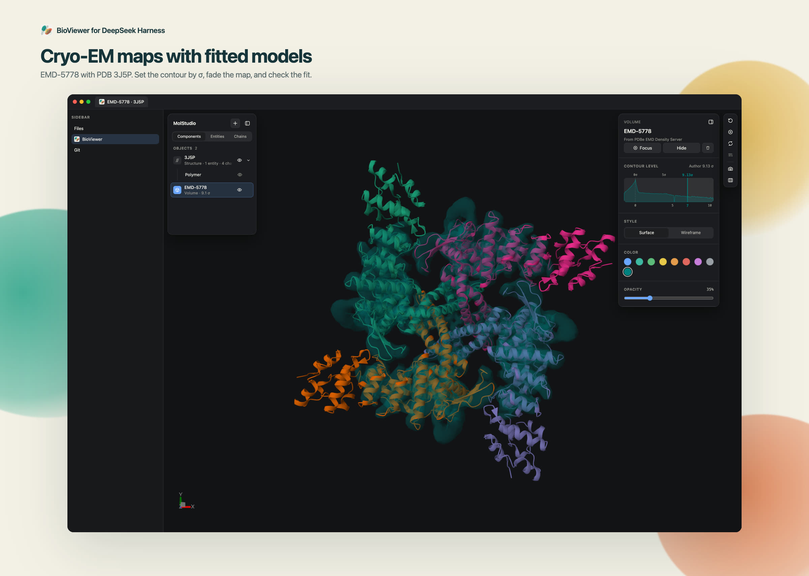
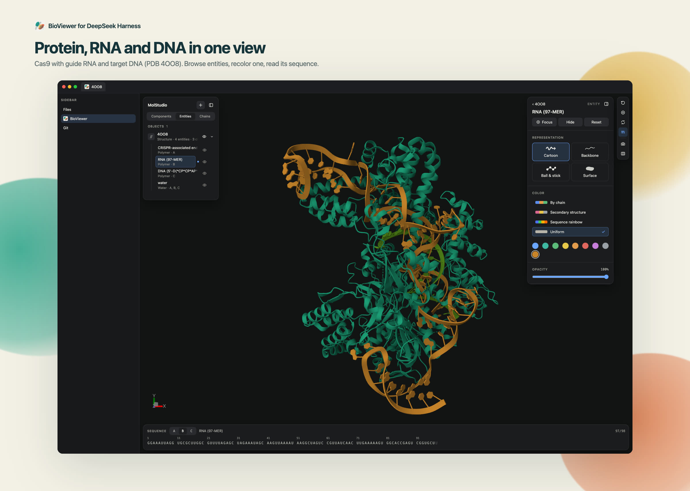
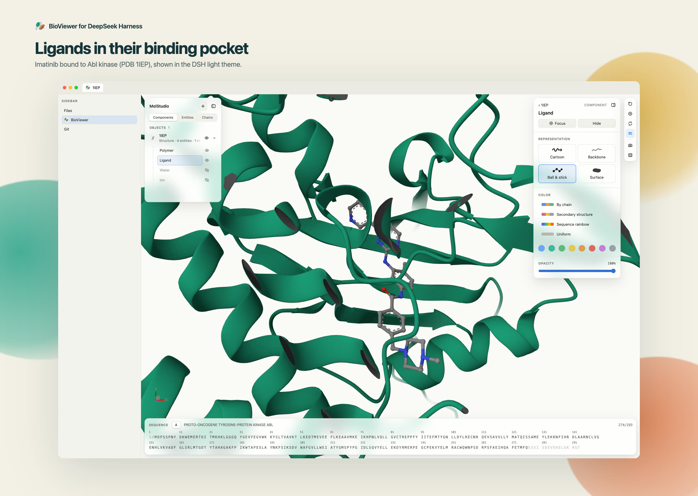
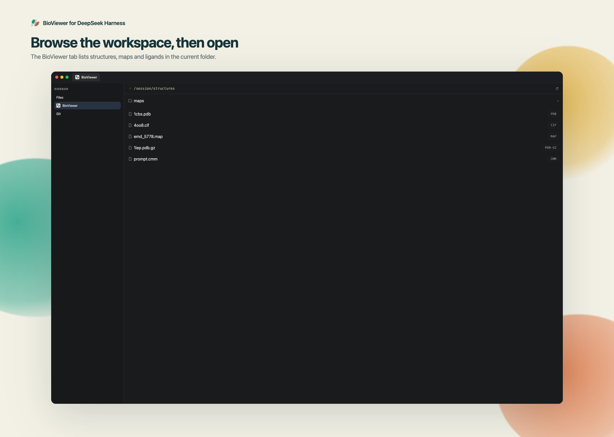

# dsh-bioviewer

[English](README_EN.md) · **中文**

在 [DeepSeek Harness](https://github.com/deepseek-ai/deepseek-harness) 侧边栏里查看生物大分子、冷冻电镜密度图与小分子。插件向 [`dsh-better-sidebar`](https://github.com/omdsh-dev/DSH-better-sidebar) 注册预览器，用 [Mol\*](https://molstar.org)（[`@molstudio/react`](https://www.npmjs.com/package/@molstudio/react)）渲染，与 [BioViewer VS Code 扩展](https://github.com/shuuul/bioviewer) 同一套 viewer。



## 功能

- PDB / mmCIF / Binary CIF、MRC 密度图、小分子，以及 Chimera `.cmm` 标记（可与密度图叠图）
- 所有格式支持 `.gz`；「BioViewer」tab 浏览工作区；跟随 DSH 明暗主题与界面语言
- 文件被改写时**替换**重载，不叠加
- 模型可用 `bio_open` 打开文件或数据库条目（`pdb:1cbs`、`alphafold:P00533`、`emdb:EMD-1234`）

## 截图







## 支持的格式

| 类别 | 扩展名 | Mol\* reader |
| --- | --- | --- |
| 结构 | `pdb` `ent` | `pdb` |
| 结构 | `cif` `mmcif` `mcif` `bcif` | `mmcif` |
| 体数据 | `mrc` `map` `ccp4` | `ccp4` |
| 小分子 | `sdf` `sd` | `sdf` |
| 小分子 | `mol` | `mol` |
| 小分子 | `mol2` | `mol2` |
| 小分子 | `pdbqt` | `pdbqt` |
| 小分子 | `gro` | `gro` |
| 小分子 | `xyz` | `xyz` |
| 标记模型 | `cmm` | MolStudio 画成球与管 |

每个扩展名也都支持 `.gz`（`1abc.pdb.gz`、`map.mrc.gz` 等）。

## 安装

```sh
dsh plugin --profile web add dsh-bioviewer
dsh plugin --profile web add dsh-better-sidebar@latest
```

没有 better-sidebar 时插件会加载，但不显示 viewer。开发用本地检出：

```sh
bun install && bun run build
dsh plugin --profile web add "link:$PWD"
```

## 市场上架

插件会出现在读取 GitHub `dsh-plugin` topic 的市场，以及 [awesome-dsh-plugin](https://github.com/awesome-dsh-plugin/awesome-dsh-plugin) 目录。商店图见 `screenshots.json`。图标与 [BioViewer VS Code 扩展](https://github.com/shuuul/bioviewer) 共用 `resources/img/icon.png`。

## 使用

侧边栏 `+` 菜单打开「BioViewer」，或从文件树 / 聊天链接打开受支持的文件。`.gz` 与未压缩文件用法相同。

## Agent 打开

`bio_open` 的 `target` 是路径或 `pdb:` / `alphafold:` / `emdb:` 条目，打开**新**标签。`bio_add` 用同样的 `target` 把对象叠进当前 BioViewer（密度图叠结构、标记叠密度图、再开一个 PDB）。没有已打开的 viewer 时 `bio_add` 会先创建一个。`title` 可选。`delivered: true` 表示已到达客户端；`false` 表示侧边栏未挂载、已排队。不支持的扩展名会被拒绝，并列出可支持格式。

## 开发

Bun **1.4.4**。`bun run verify:fast` 是 pre-push 与 CI 的门禁。架构与宿主契约见 [AGENTS.md](AGENTS.md)；规格见 [规格索引](specs/README.md)；[历史验证](docs/VERIFICATION.md) 不是当前验收。

```sh
bun install
bun run verify:fast
```

## 已知限制

工作区浏览器只列一层。

## 许可证

MIT
