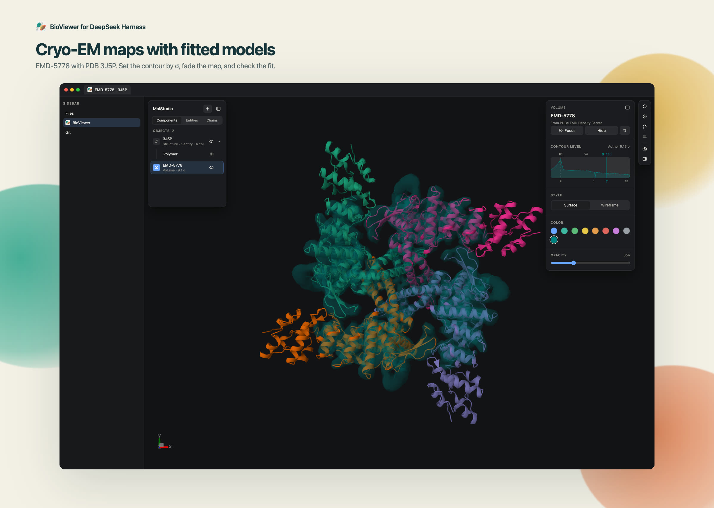
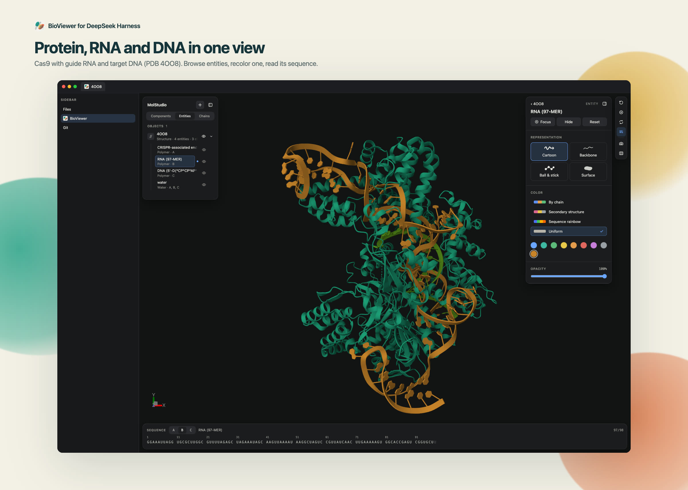
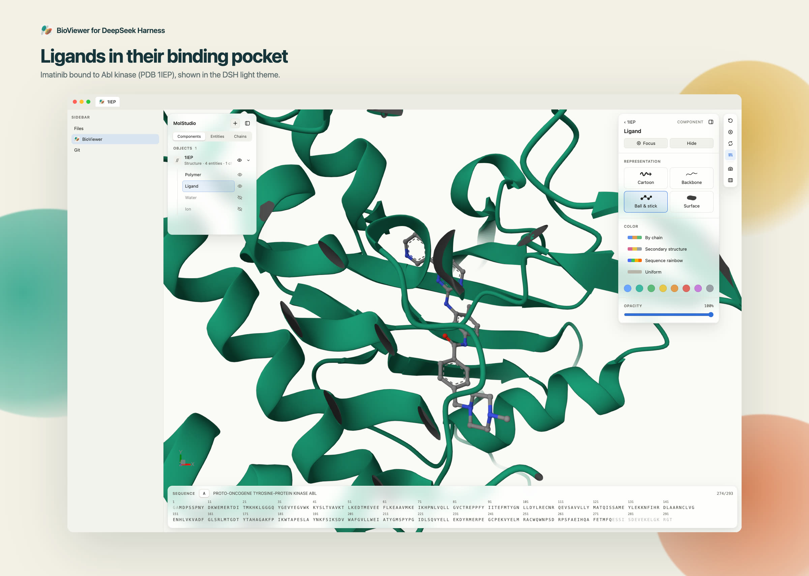
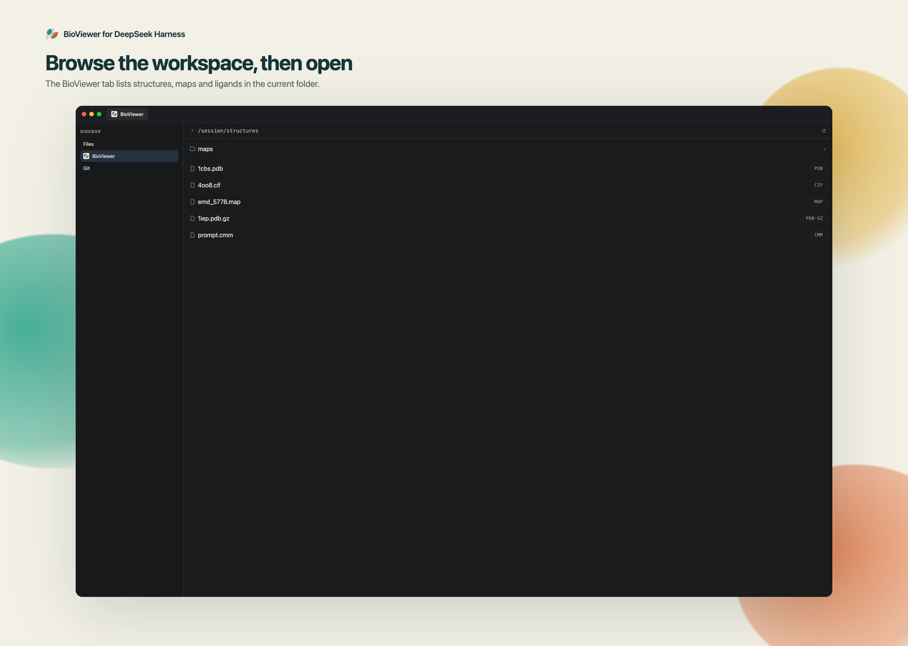

# dsh-bioviewer

[English](README_EN.md) · **中文**

在 [DeepSeek Harness](https://github.com/deepseek-ai/deepseek-harness) 侧边栏里查看生物大分子、冷冻电镜密度图与小分子。插件向 [`dsh-better-sidebar`](https://github.com/omdsh-dev/DSH-better-sidebar) 注册预览器，用 [Mol\*](https://molstar.org)（[`@molstudio/react`](https://www.npmjs.com/package/@molstudio/react)）渲染，与 [BioViewer VS Code 扩展](https://github.com/shuuul/bioviewer) 同一套 viewer。



## 功能

- PDB / mmCIF / Binary CIF、MRC 密度图、小分子，以及 Chimera `.cmm` 标记（可与密度图叠图）
- 所有格式支持 `.gz`；「BioViewer」tab 浏览工作区；跟随 DSH 明暗主题与界面语言
- 文件被改写时**替换**重载，不叠加
- 模型可用 `bio_open` 打开文件或数据库条目（`pdb:1cbs`、`alphafold:P00533`、`emdb:EMD-1234`）

## 密度图加速（Wasm）

从 [`@molstudio/core`](https://www.npmjs.com/package/@molstudio/core) 0.1.6 起，密度图的等值面改由 MolStudio 自带的 WebAssembly marching-cubes 内核重建。插件把这份 54 KB 的 `molstudio-wasm-engine.wasm` 和它的 worker 一起以 base64 内嵌进 `lib/client.js`，随插件分发：不新增资源路由，不依赖 `node_modules`、CDN 或构建机路径，离线可用。运行时先试 worker 里的引擎（不占界面线程），没有 worker 就用主线程里的同一份 wasm，两者都不可用才回落到 Mol\* 自己的等值面。资产由 `bun run sync:molstudio-assets` 从已安装的 `@molstudio/core` 重新生成。

同样的网格、同样的等值面、同样的三角形数，直接对比两套 marching cubes（Chrome 157 / V8，单线程，真实 EMDB 数据）：

| 重建的网格 | 三角形 | Mol\* JS 内核 | wasm 内核 | 倍数 |
| --- | --- | --- | --- | --- |
| 65³ | 10 k | 9 ms | <1 ms | 22.8× |
| 113³ | 117 k | 35 ms | 4 ms | 9.2× |
| 146³ | 112 k | 58 ms | 6 ms | 9.1× |
| 251³ | 3.2 M | 440 ms | 97 ms | 4.6× |

表面越密，倍数越接近下限：几百万三角形时约 2–5 倍（我们另用 1000 万三角形的噪声网格测得 3.4 倍）。

**但打开一张图并没有变快，反而更慢。** 一样的加载流程（`loadVolume`，每个数值 3–5 次取中位数）：

| 密度图 | 网格 | 0.1.5 | 0.1.6 + wasm | 0.1.6 实际重建的网格 |
| --- | --- | --- | --- | --- |
| EMD-1832 | 64³ | 1.44 s | 2.14 s | 64³ |
| EMD-3318 | 112³ | 1.49 s | 2.06 s | 112³ |
| EMD-10088 | 290³ | **0.61 s** | 2.22 s | **145³**（降采样 2×） |
| EMD-10087 | 500³ | **4.26 s** | 5.41 s | **250³**（降采样 2×） |

三条原因叠加在一起：

1. 0.1.6 每次加载都有约 2 s 的固定开销（64³ 与 250³ 的差距只有 0.3 s），meshing 省下的几百毫秒被它淹掉；
2. 对周期网格（EMDB 密度图全部如此）0.1.6 **不再使用 Mol\* 的 GPU 等值面**，一律走 CPU；
3. 超过纹理上限的网格会被**无条件降采样**（290³ → 145³、500³ → 250³，宿主无法关闭），而且相对等值面按降采样后的统计量换算（2σ 从 0.0157 变 0.0143），画出来的是另一张表面——EMD-10088 上从 84.1 万三角形降到 11.2 万。

测量环境是 headless Chrome + 软件 GL（SwiftShader），不是你的显卡。前两行 0.1.5 的 1.4 s 里 GPU 路径被软件光栅化拖慢（同一张网格用 CPU 只要 9 ms），所以 64³/112³ 的差距不能直接当真机结论；但真机 GPU 只会让 0.1.5 更快，而第 2、3 条与显卡无关。

## 截图







## 支持的格式

| 类别 | 扩展名 | Mol\* reader |
| --- | --- | --- |
| 结构 | `pdb` `ent` | `pdb` |
| 结构 | `cif` `mmcif` `mcif` `bcif` | `mmcif` |
| 体数据 | `mrc` `map` `ccp4` | `ccp4` |
| 小分子 | `sdf` `sd` | `sdf` |
| 小分子 | `mol` | `mol` |
| 小分子 | `mol2` | `mol2` |
| 小分子 | `pdbqt` | `pdbqt` |
| 小分子 | `gro` | `gro` |
| 小分子 | `xyz` | `xyz` |
| 标记模型 | `cmm` | MolStudio 画成球与管 |

每个扩展名也都支持 `.gz`（`1abc.pdb.gz`、`map.mrc.gz` 等）。

## 安装

需要 **DSH 0.2.2-rc.1** 或更新版本（`cordis` 4.1.0、Node.js 24.9+）。

```sh
dsh plugin --profile web add dsh-bioviewer
dsh plugin --profile web add dsh-better-sidebar@latest
```

没有 better-sidebar 时插件会加载，但不显示 viewer。开发用本地检出：

```sh
bun install && bun run build
dsh plugin --profile web add "link:$PWD"
```

## 市场上架

插件会出现在读取 GitHub `dsh-plugin` topic 的市场，以及 [awesome-dsh-plugin](https://github.com/awesome-dsh-plugin/awesome-dsh-plugin) 目录。商店图见 `screenshots.json`。图标与 [BioViewer VS Code 扩展](https://github.com/shuuul/bioviewer) 共用 `resources/img/icon.png`。

## 使用

侧边栏 `+` 菜单打开「BioViewer」，或从文件树 / 聊天链接打开受支持的文件。`.gz` 与未压缩文件用法相同。

## Agent 打开

`bio_open` 的 `target` 是路径或 `pdb:` / `alphafold:` / `emdb:` 条目，打开**新**标签。`bio_add` 用同样的 `target` 把对象叠进当前 BioViewer（密度图叠结构、标记叠密度图、再开一个 PDB）。没有已打开的 viewer 时 `bio_add` 会先创建一个。`title` 可选。`delivered: true` 表示已到达客户端；`false` 表示侧边栏未挂载、已排队。不支持的扩展名会被拒绝，并列出可支持格式。

## 开发

Bun **1.4.4**。`bun run verify:fast` 是 pre-push 与 CI 的门禁。架构与宿主契约见 [AGENTS.md](AGENTS.md)；规格见 [规格索引](specs/README.md)；[历史验证](docs/VERIFICATION.md) 不是当前验收。

```sh
bun install
bun run verify:fast
```

## 已知限制

工作区浏览器只列一层。

## 许可证

MIT
