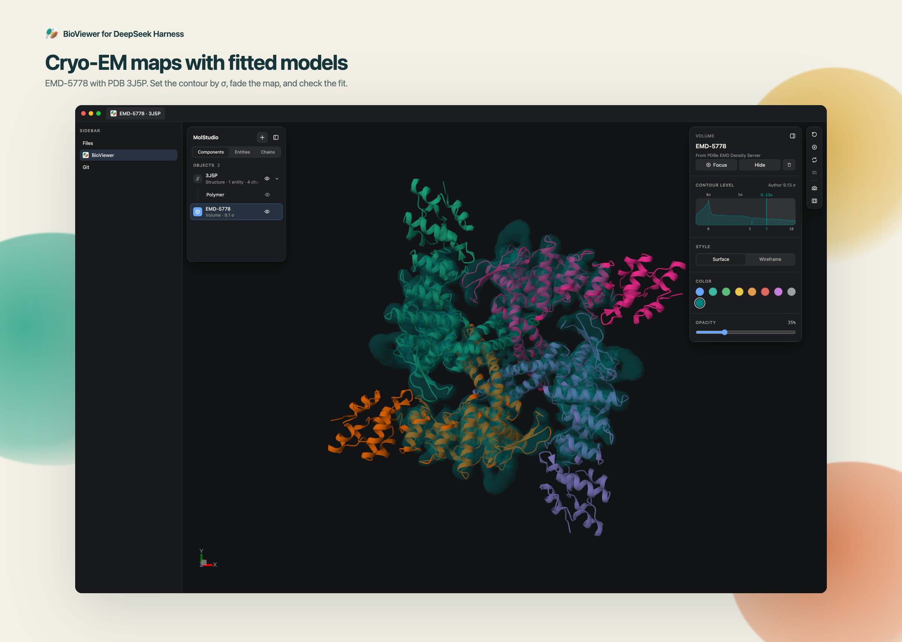
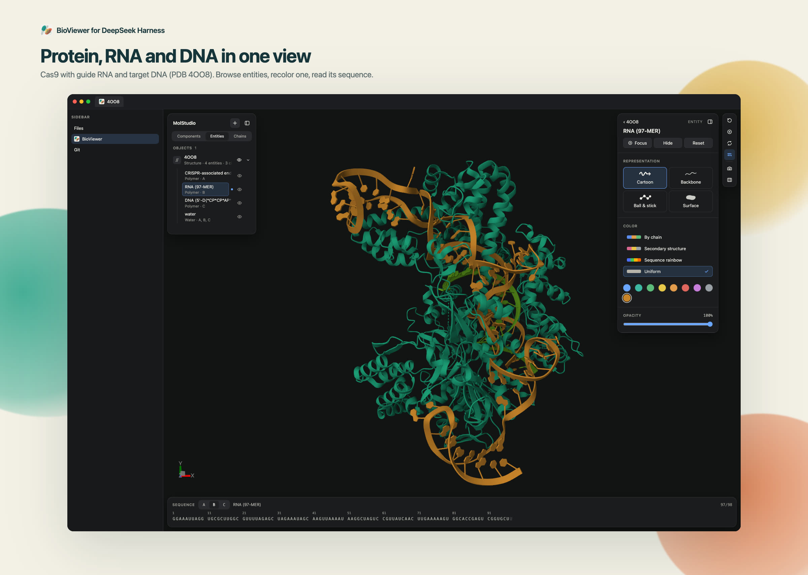
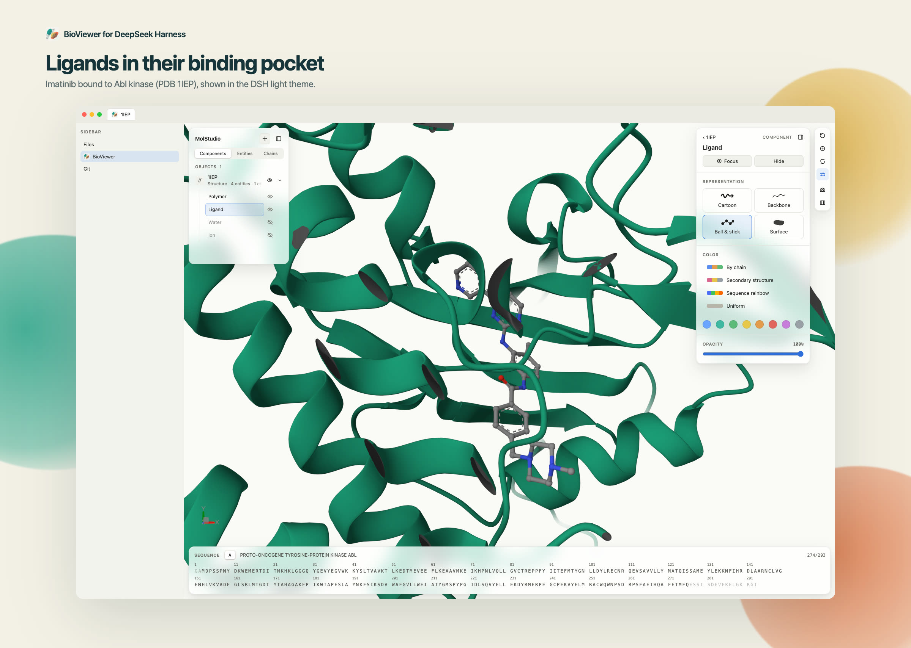
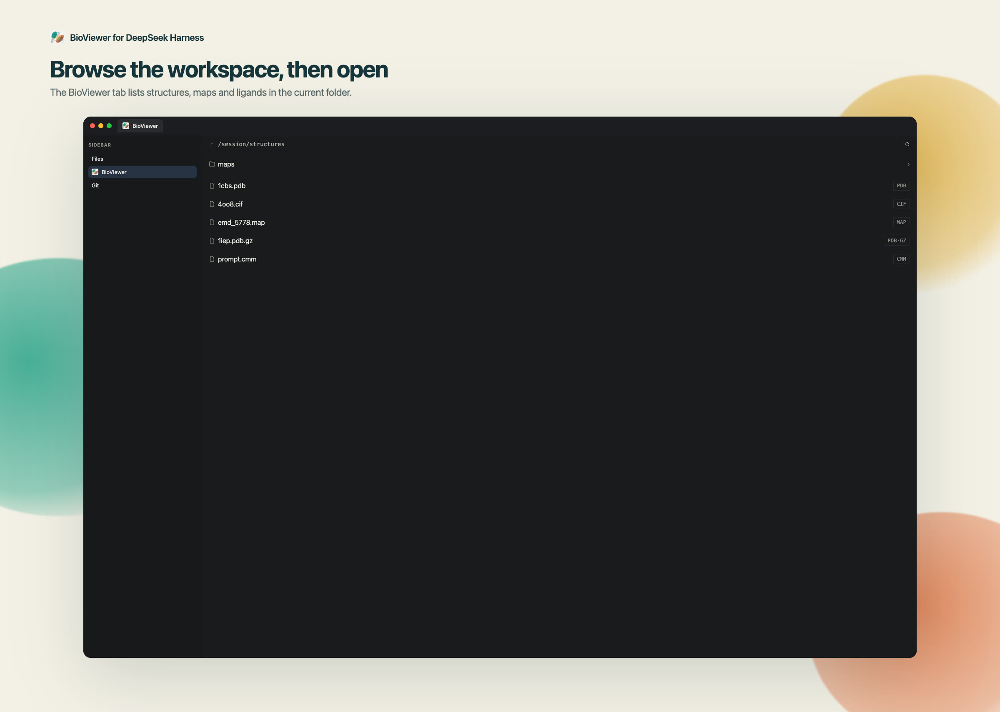

# dsh-bioviewer

**English** · [中文](README.md)

View biomolecular structures, cryo-EM maps and small molecules in the
[DeepSeek Harness](https://github.com/deepseek-ai/deepseek-harness) sidebar. The
plugin registers viewers with [`dsh-better-sidebar`](https://github.com/omdsh-dev/DSH-better-sidebar)
and renders them with [Mol\*](https://molstar.org) via
[`@molstudio/react`](https://www.npmjs.com/package/@molstudio/react) — the same
stack as the [BioViewer VS Code extension](https://github.com/shuuul/bioviewer).



## Features

- PDB / mmCIF / Binary CIF, MRC maps, small molecules, and Chimera `.cmm` markers (can overlay a map)
- `.gz` on every format; a "BioViewer" tab lists workspace files; follows the DSH theme and language
- Reloads **replace** the old object when the file is rewritten
- The model can call `bio_open` for a file or a database entry (`pdb:1cbs`, `alphafold:P00533`, `emdb:EMD-1234`)

## Density-map acceleration (Wasm)

Since [`@molstudio/core`](https://www.npmjs.com/package/@molstudio/core) 0.1.6, density-map
isosurfaces are rebuilt by a WebAssembly marching-cubes kernel shipped inside MolStudio.
The plugin embeds that ~55 KB `molstudio-wasm-engine.wasm` together with its worker as
base64 in `lib/client.js`, so it travels with the plugin: no extra asset route, no
`node_modules`, CDN or build-machine path, and it works offline. At runtime the worker
tier is tried first (the UI thread stays free), then the same wasm on the main thread,
and only then Mol\*'s own isosurface. `bun run sync:molstudio-assets` regenerates the
assets from the installed `@molstudio/core`.

Same grid, same iso level, same triangle count, the two marching-cubes implementations
head to head (Chrome 157 / V8, single thread, real EMDB data):

| Grid meshed | Triangles | Mol\* JS kernel | wasm kernel | Speedup |
| --- | --- | --- | --- | --- |
| 65³ | 10 k | 9 ms | <1 ms | 22.8× |
| 113³ | 117 k | 35 ms | 4 ms | 9.2× |
| 146³ | 112 k | 58 ms | 6 ms | 9.1× |
| 251³ | 3.2 M | 440 ms | 97 ms | 4.6× |

The denser the surface, the closer the ratio gets to its floor: about 2-5× once a grid
produces millions of triangles (a 10-million-triangle noise grid measured 3.4×).

From [`@molstudio/core`](https://www.npmjs.com/package/@molstudio/core) **0.1.8**, periodic
solid isosurfaces use Mol\*'s GPU texture-mesh again (the same `useGpu` gate as 0.1.5).
Opening a typical cryo-EM map **does not start a worker**. Wasm accelerates the CPU path
only: wireframe, missing float textures, software GL. Oversized grids downsample
in-process with wasm `ds_from_staging`; if the reduced grid fits, it then takes the GPU path.

On real hardware (ANGLE Metal, Apple M2 Pro): a 300³ periodic solid opens at parity with
0.1.5 (~455–473 ms, no worker, texture-mesh), with iso-drag around 17 ms; wireframe iso is
about 8× (~1 s → ~120 ms); a 512³ map downsamples to 256³ then stays on GPU (open 2.9 →
1.3 s, iso about 230–280× vs 0.1.5's ~4 s CPU). Earlier SwiftShader open-time tables are
not the product claim.

The current dependency is **0.1.9**: a malformed map or an empty structure now fails
visibly (the load rejects, the partial state is cleaned up, and the pane shows the
error with a retry), and an EMDB map whose author-recommended contour cannot be
fetched still opens at its parsed contour.

## Screenshots







## Supported formats

| Kind | Extensions | Mol\* reader |
| --- | --- | --- |
| Structure | `pdb` `ent` | `pdb` |
| Structure | `cif` `mmcif` `mcif` `bcif` | `mmcif` |
| Volume | `mrc` `map` `ccp4` | `ccp4` |
| Molecule | `sdf` `sd` | `sdf` |
| Molecule | `mol` | `mol` |
| Molecule | `mol2` | `mol2` |
| Molecule | `pdbqt` | `pdbqt` |
| Molecule | `gro` | `gro` |
| Molecule | `xyz` | `xyz` |
| Marker model | `cmm` | drawn by MolStudio as spheres and tubes |

Every extension also works with a `.gz` suffix (`1abc.pdb.gz`, `map.mrc.gz`, …).

## Install

Requires **DSH 0.2.2-rc.1** or newer (`cordis` 4.1.0, Node.js 24.9+).

```sh
dsh plugin --profile web add dsh-bioviewer
dsh plugin --profile web add dsh-better-sidebar@latest
```

Without better-sidebar the plugin loads but shows nothing. From a local checkout:

```sh
bun install && bun run build
dsh plugin --profile web add "link:$PWD"
```

## Marketplace

The plugin is listed by GitHub `dsh-plugin` topic crawlers and the
[awesome-dsh-plugin](https://github.com/awesome-dsh-plugin/awesome-dsh-plugin)
catalog. Storefront shots live in `screenshots.json`. The icon is the same
DNA-and-protein mark as the [BioViewer VS Code extension](https://github.com/shuuul/bioviewer)
(`resources/img/icon.png`).

## Usage

Open the "BioViewer" tab from the sidebar `+` menu, or open a supported file from
the file tree or a chat link. `.gz` files work like their uncompressed twins.

## Agent opens

`bio_open` takes a path or a `pdb:` / `alphafold:` / `emdb:` entry and opens a
**new** tab. `bio_add` uses the same `target` to stack an object into the live
BioViewer (overlay a map on a structure, draw markers on a map, load a second
PDB). If no viewer is open, `bio_add` creates one. `title` is optional.
`delivered: true` means it reached a client; `false` means the sidebar is not
mounted and the request is queued. Unsupported extensions are refused with the
supported list.

## Development

Bun **1.4.4**. `bun run verify:fast` is the pre-push and CI gate. Architecture
and host contracts: [AGENTS.md](AGENTS.md). Specs: [spec index](specs/README.md).
[Historical verification](docs/VERIFICATION.md) is not current acceptance.

```sh
bun install
bun run verify:fast
```

## Limitations

The workspace browser lists one directory level.

## License

MIT
